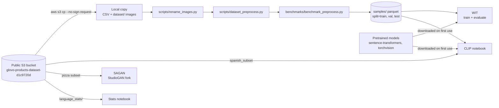

<div align="center">

# 🛠️ foodi-ml-dataset

**Download, prepare and benchmark FooDI-ML, Glovo's public multilingual food and grocery image–text dataset**

This repo is the companion code for the **FooDI-ML** dataset: how to download it, two scripts that point
the dataset's CSV at your local images and filter it, a dataset-statistics notebook, and the code for the
paper's three benchmarks. It is **not** the dataset itself (the CSV and images live in a public S3 bucket),
and it is not a service: nothing here is built, deployed or run by CI.

[](benchmarks/wit/requirements.txt)
[](benchmarks/wit/requirements.txt)
[](#data-model)
<br/>
[](LICENSE)
[](https://creativecommons.org/licenses/by-nc-sa/2.0/)
[](https://arxiv.org/abs/2110.02035)

</div>

---

## Table of contents

- [Overview](#overview)
- [Architecture](#architecture)
- [External integrations](#external-integrations)
- [Data model](#data-model)
- [Build & local development](#build--local-development)
- [Repository layout](#repository-layout)
- [Contributing & conventions](#contributing--conventions)
- [Glossary](#glossary)
- [Ownership & support](#ownership--support)

---

## Overview


The **Food Drinks and groceries Images Multi Lingual (FooDI-ML)** dataset contains over **1.5M unique images**
and over **9.5M store names, product names, descriptions and collection sections** gathered from the Glovo
application. It covers food, drinks and groceries products from over **37 countries** in Europe, the Middle
East, Africa and Latin America, in **33 languages**. That includes 870k samples in languages of Eastern Europe
and West Asia such as Ukrainian and Kazakh, which have so far been underrepresented in publicly available
visio-linguistic datasets, as well as widely spoken languages such as Spanish and English.

You download the CSV and the images with the AWS CLI (no AWS account needed), run
[`rename_images.py`](scripts/rename_images.py) so each row points at your local image, and run
[`dataset_preprocess.py`](scripts/dataset_preprocess.py) to drop the rows whose image is missing. The result is
a local DataFrame you can use directly, or feed to the **WIT**, **CLIP** and **SAGAN** benchmarks from the paper.

| | |
|---|---|
| **Language / build** | Python 3 scripts and Jupyter notebooks; no package or build system |
| **Storage** | Public S3 bucket `glovo-products-dataset-d1c9720d`: CSV of 540 MB, images of 316.1 GB |
| **Benchmarks** | Text↔image retrieval: [WIT](benchmarks/wit/README.md), [CLIP](benchmarks/clip/README.md) · Conditional image generation: [SAGAN](benchmarks/gan/README-foodi-ml.md) |
| **Licence** | Dataset: [BY-NC-SA](https://creativecommons.org/licenses/by-nc-sa/2.0/ "BY-NC-SA license") · Code: MIT ([`LICENSE`](LICENSE)) · [`benchmarks/gan/`](benchmarks/gan) keeps its own licences |
| **Paper** | [arXiv:2110.02035](https://arxiv.org/abs/2110.02035): cite it when you use the dataset |

---

## Architecture

Everything runs on your machine: data comes down from the public bucket and pretrained models come down on
first use.



`rename_images.py` and `dataset_preprocess.py` rewrite the CSV in place. [`benchmark_preprocess.py`](benchmarks/benchmark_preprocess.py)
turns it into a parquet folder partitioned by split, which WIT and the CLIP notebook read. SAGAN trains on a
separate pizza subset of the bucket.

---

## External integrations

| Integration | Upstream | Direction | Purpose | Auth |
|---|---|---|---|---|
| Dataset bucket | S3 `glovo-products-dataset-d1c9720d` | → out | CSV, images, `spanish_subset`, `language_stats/` | none (`--no-sign-request`) |
| WIT text tower | sentence-transformers `stsb-xlm-r-multilingual` ([`network.py`](benchmarks/wit/network.py)) | → out | Multilingual text embeddings | none |
| WIT image tower | torchvision `resnet50(pretrained=True)` ([`network.py`](benchmarks/wit/network.py)) | → out | Image embeddings | none |
| CLIP | sentence-transformers `clip-ViT-B-32-multilingual-v1` (text) and `clip-ViT-B-32` (images) | → out | Retrieval with pretrained encoders in the [CLIP notebook](benchmarks/clip/CLIP-MultiLingual-FoodiML-SpanishSample.ipynb) | none |

- There are **no retries or fallbacks**. The only guard is in `dataset_preprocess.py`: it asserts that the
  first image path exists, then drops every row whose image file is missing.
- **~30 image names** are in the DataFrame but not in the S3 bucket, so some rows always get dropped
  (comment in [`dataset_preprocess.py`](scripts/dataset_preprocess.py)).

---

## Data model

The dataset is one CSV plus PNG images in the public bucket. Nothing in this repo creates or writes to the
bucket.

### Bucket objects this repo uses

| Object | Size | Used by |
|---|---|---|
| `glovo-foodi-ml-dataset.csv` | 540 MB | everything |
| `dataset/` | 316.1 GB of images | the scripts and all benchmarks |
| `spanish_subset.csv` and `spanish_subset.zip` | | the CLIP notebook |
| `language_stats/` | | the stats notebook |

### Columns of `glovo-foodi-ml-dataset.csv`

| Column | Meaning |
|---|---|
| `country_code` | 37 unique country codes, as explained in the paper (list below) |
| `city_code` | Name of the city where the store is located |
| `store_name` | Store selling the product. `AS_XYZ` means an **auxiliary store**: the sample is mostly valid, but the store name can't be used in learning tasks |
| `product_name` | Name of the product. Every product has one, so there are no `NaN` values |
| `collection_section` | Menu section the product sits in, e.g. _"drinks", "our pizzas", "desserts"_. Every product has one, so there are no `NaN` values |
| `product_description` | Detailed description with ingredients and components. **Not all products have one: this column contains `NaN` values that researchers must remove as a preprocessing step** |
| `subset` | `train`, `val` or `test` |
| `hash` | Image hash. `benchmark_preprocess.py` de-duplicates on it together with the three text columns |
| `aux_store` | Boolean flag for auxiliary stores (`AS_XYZ`) |
| `HIER` | Boolean: `True` when `store_name` can be used to retrieve product information, i.e. it is **not** an auxiliary store |
| `s3_path` | Image path. In the download it is `dataset/<image>.png`; after `rename_images.py` it is the path on your disk |

<details><summary><b>The 37 country codes</b></summary>

```text
'ES', 'PL', 'CI', 'PT', 'MA', 'IT', 'AR', 'BG', 'KZ', 'BR', 'ME', 'TR', 'PE', 'SI', 'GE', 'EG', 'RS', 'RO', 'HR', 'UA', 'DO', 'KG', 'CR', 'UY', 'EC', 'HN', 'GH', 'KE', 'GT', 'CL', 'FR', 'BA', 'PA', 'UG', 'MD', 'NG', 'PR'
```

</details>

### Benchmark parquet (`samples/`)

[`benchmark_preprocess.py`](benchmarks/benchmark_preprocess.py) writes `<dataset-path>/samples/`, partitioned
by `split` (`train`, `val`, `test`), with the columns `caption`, `img_id`, `s3_path`, `country_code` and
`hash`. The `caption` is the lower-cased `product_name` + `collection_section` + `product_description`.
That aggregation is an algorithm choice: researchers can use the text fields however they like.

---

## Build & local development

> [!NOTE]
> You need the [AWS CLI](https://aws.amazon.com/cli/ "AWS CLI page") (latest version for your OS), Python 3 with
> `pandas`, and about **317 GB** of free disk (540 MB CSV + 316.1 GB of images). No AWS credentials: every
> command uses `--no-sign-request`. The benchmarks are meant for an NVIDIA GPU (the SAGAN commands set
> `CUDA_VISIBLE_DEVICES` and its environment pins CUDA 11.0); WIT falls back to CPU.

### Download FooDI-ML

`dataset_preprocess.py`'s error message sends you to "the 3rd step of section 1.2 of the README.md": that is
step 3 below.

```bash
DEST=/mnt/data/foodi-ml   # your ENTER_DESTINATION_PATH; this example is from the original guide

# 1. The DataFrame (540 MB)
aws s3 cp s3://glovo-products-dataset-d1c9720d/glovo-foodi-ml-dataset.csv "$DEST/" --no-sign-request

# 2. The images (316.1 GB), into $DEST/dataset — note the appended /dataset
aws s3 cp --recursive s3://glovo-products-dataset-d1c9720d/dataset "$DEST/dataset" --no-sign-request --quiet

# 3. Point s3_path at your copy (rewrites the CSV in place)
pip install pandas
python scripts/rename_images.py --output-dir "$DEST"

# 4. Filter the dataset: drop rows whose image is missing
python scripts/dataset_preprocess.py --dataset-path "$DEST"
```

> [!WARNING]
> The images **must** sit in `$DEST/dataset`. `rename_images.py` joins `--output-dir` with the CSV's
> `dataset/<image>.png` paths, and `dataset_preprocess.py` stops if the first path doesn't exist.

### Reproduce the paper's benchmarks

| Benchmark | Task | Entry point | Full guide |
|---|---|---|---|
| WIT | Text↔image retrieval | [`train_network.py`](benchmarks/wit/train_network.py), [`evaluate_network_bigdata.py`](benchmarks/wit/evaluate_network_bigdata.py) | [`benchmarks/wit/README.md`](benchmarks/wit/README.md) |
| CLIP | Text↔image retrieval on a Spanish sample | [notebook](benchmarks/clip/CLIP-MultiLingual-FoodiML-SpanishSample.ipynb) | [`benchmarks/clip/README.md`](benchmarks/clip/README.md) |
| SAGAN | Conditional generation of 4 pizza classes | [`src/main.py`](benchmarks/gan/src/main.py) + [`SAGAN.json`](benchmarks/gan/src/configs/TINY_ILSVRC2012/SAGAN.json) | [`benchmarks/gan/README-foodi-ml.md`](benchmarks/gan/README-foodi-ml.md) |

```bash
python3 -m venv foodi-ml-venv && source foodi-ml-venv/bin/activate
pip install -r benchmarks/wit/requirements.txt        # WIT and CLIP share it
export PYTHONPATH=$PYTHONPATH:<ENTER_PATH_TO_REPO_FOLDER>   # the scripts import benchmarks.wit.*

python benchmarks/benchmark_preprocess.py --dataset-path "$DEST"   # writes $DEST/samples/
python benchmarks/wit/train_network.py --dataset-path "$DEST" --epochs 50 --batch-size 160   # saves ./trained_model_<epoch>.pth every epoch
python benchmarks/wit/evaluate_network_bigdata.py --dataset-path "$DEST" --code-path <PATH_TO_REPO_FOLDER> --model-weights <PATH_TO_MODEL_WEIGHTS>
```

- **Re-running** `benchmark_preprocess.py` deletes and rewrites `$DEST/samples/`.
- **Cached embeddings:** `evaluate_network_bigdata.py` saves `img_embeddings.pt` and `txt_embeddings.pt` in
  `--dataset-path` and reuses them on the next run, ignoring `--model-weights`. Delete them before evaluating
  other weights. Metrics go to `t2i_metrics.pkl` and `i2t_metrics.pkl` in the current directory, and the
  validation batch size (70) is tuned for one GPU with 32 GB.
- **CLIP notebook:** its paths cell hard-codes SageMaker paths under `/home/ec2-user/SageMaker/` and reads a
  local copy of the bucket's `spanish_subset.csv`. An early cell opens `valid_answers_spanish_subset.pickle`, which isn't
  committed (a later cell recomputes it). Edit those cells first.
- **SAGAN:** create the conda environment from [`environment.yml`](benchmarks/gan/environment.yml) (Python 3.7.6,
  PyTorch 1.7.1, CUDA 11.0), set `data_path` in `SAGAN.json`, and run the commands from `benchmarks/gan/`.

> [!WARNING]
> Expect to fix the SAGAN path before it runs (checked 2026-10-29): `pizza_subset.csv` and `pizza_subset.zip`
> return 404 from the bucket, which holds `spanish_subset_pizza.csv` and `.zip` instead;
> [`load_dataset.py`](benchmarks/gan/src/data_utils/load_dataset.py) calls `FoodiMLDataset(dataset_path=…)` but
> [`our_datasets.py`](benchmarks/gan/src/data_utils/our_datasets.py) takes `data_path` and reads `foodi-ml-train.csv`.

### Dataset statistics

`FooDI-ML Dataset Stats Analytics.ipynb` in [`notebooks/`](notebooks) analyses several dataset statistics. Its first cells download `language_stats/` into the current directory:

```bash
aws s3 cp --recursive s3://glovo-products-dataset-d1c9720d/language_stats/ . --no-sign-request
```

---

## Repository layout

```text
foodi-ml-dataset/
├── scripts/                     ⭐ dataset preparation
│   ├── rename_images.py         # step 3: point s3_path at your local images
│   ├── dataset_preprocess.py    # step 4: drop rows whose image is missing
│   └── hash_images.py           # dhash() image-hash helper, no CLI
├── benchmarks/
│   ├── benchmark_preprocess.py  # CSV → samples/ parquet for WIT and CLIP
│   ├── wit/                     # WIT retrieval: train, evaluate, requirements.txt
│   ├── clip/                    # multilingual CLIP notebook on a Spanish sample
│   └── gan/                     # SAGAN on a vendored PyTorch-StudioGAN, with its own licences
├── notebooks/                   # dataset statistics notebook
├── imgs/                        # images used by this README
└── LICENSE                      # MIT, for the code
```

---

## Contributing & conventions

1. **Two licences.** The code is MIT ([`LICENSE`](LICENSE)); the dataset is BY-NC-SA, so non-commercial. Keep
   the two apart in docs and code comments.
2. **Vendored GAN code.** [`benchmarks/gan/`](benchmarks/gan) is PyTorch-StudioGAN
   ([`LICENSE`](benchmarks/gan/LICENSE), MIT) and the CUDA kernels in `src/utils/ada_op/` are under the NVIDIA
   Source Code License-NC ([`LICENSE-NVIDIA`](benchmarks/gan/LICENSE-NVIDIA)). Keep both files and the upstream
   [`README.md`](benchmarks/gan/README.md); put FooDI-ML notes in [`README-foodi-ml.md`](benchmarks/gan/README-foodi-ml.md).
3. **Download step numbers.** `dataset_preprocess.py` points users to "the 3rd step of section 1.2" of this
   README. If you renumber the download steps, update that message too.
4. **Dependencies are pinned** in [`benchmarks/wit/requirements.txt`](benchmarks/wit/requirements.txt);
   Dependabot opens bump PRs against it.
5. **No tests, linters or CI** are configured. Check a change by running the script you touched against a
   downloaded copy.
6. There is no CODEOWNERS file, so GitHub requests no reviewers automatically.

---

## Glossary

| Term | Meaning |
|---|---|
| FooDI-ML | Food Drinks and groceries Images Multi Lingual, the dataset this repo serves |
| Auxiliary store (`AS_XYZ`) | Placeholder `store_name`; the sample is usable but the store name isn't |
| `HIER` | Column that is `True` when the store name is real and usable |
| Collection section | Menu section a product belongs to in the store, e.g. "desserts" |
| t2i / i2t | Text-to-image / image-to-text retrieval, the two directions WIT and CLIP are scored on |
| WIT | The dual-encoder retrieval baseline in [`benchmarks/wit/`](benchmarks/wit): multilingual text tower + ResNet-50 image tower |
| CLIP | OpenAI's image–text model, used here through its multilingual sentence-transformers version |
| SAGAN | Self-Attention GAN, trained here with StudioGAN for conditional image generation |

---

## Ownership & support

- **Team:** none declared. There is no `.github/CODEOWNERS` or `catalog-info.yaml`, and the GitHub topics are
  `p-none` · `t-none`.
- **Questions and bugs:** [GitHub issues](https://github.com/Glovo/foodi-ml-dataset/issues); the repo is public.
